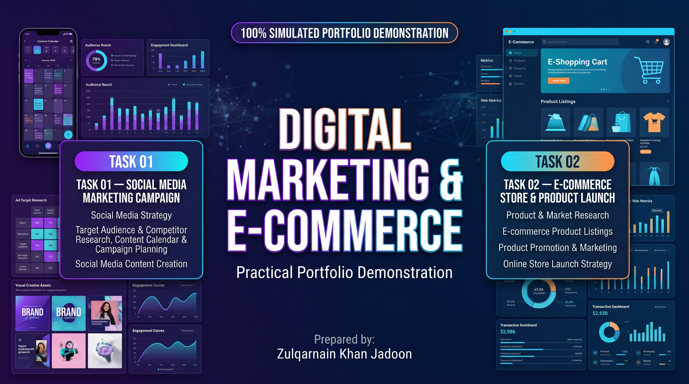

# Digital Marketing & E-commerce Portfolio

**Prepared by:** Zulqarnain Khan Jadoon  
**Project Area:** Digital Marketing & E-commerce  
**Location:** Abbottabad, Khyber Pakhtunkhwa, Pakistan  
**Project Type:** Simulated Portfolio Demonstration  
**Status:** Learning and Demonstration Tasks Documented

## Portfolio Visuals

The repository includes a set of visual assets prepared for the two practical tasks in this portfolio.

---

## Project Overview

This portfolio demonstrates the practical application of digital marketing and e-commerce concepts through two structured case studies. It covers market research, audience identification, campaign planning, social media content development, product presentation, and e-commerce launch strategy.

The work is prepared as a simulated professional portfolio project to demonstrate practical skills and learning outcomes.

## Task 01: Social Media Marketing Campaign

A practical campaign-planning exercise focused on building an organized social media marketing strategy.

**Key Activities:**
- Target audience identification and market research
- Competitor analysis
- Social media marketing strategy
- Content calendar development
- Post concepts, captions, and hashtag planning
- Campaign performance indicators (KPIs)

**Skills Demonstrated:** Social Media Marketing, Market Research, Content Planning, Campaign Strategy and Digital Communication.

## Task 02: E-commerce Store & Product Launch

A practical exercise covering the planning and promotion of an e-commerce product launch.

**Key Activities:**
- Product and market research
- Product listing and description planning
- Pricing and product presentation
- Promotional content and design concepts
- Product launch campaign planning
- Sales and performance tracking

**Skills Demonstrated:** E-commerce Fundamentals, Product Research, Product Listing, Promotional Planning and Performance Monitoring.

## Tools & Skills

- Google Workspace
- Canva
- AI-assisted content planning
- Social Media Strategy
- Market and Competitor Research
- E-commerce Product Presentation
- Campaign Planning and Reporting

## Portfolio Disclaimer

This repository contains simulated case studies and practical learning demonstrations. The organization, campaign activities, product examples, and performance scenarios are illustrative and should not be interpreted as verified client work or actual commercial results.

---

**Prepared by Zulqarnain Khan Jadoon**